# AppScout

App Store 앱을 검색하고, 상세 정보를 보고, 마음에 드는 앱을 즐겨찾기로 모아 두는 iOS 앱입니다.
SwiftUI + TCA(The Composable Architecture)로 만든 앱과, 로컬에서 돌아가는 FastAPI + MySQL 서버로 구성되어 있습니다.

<p>
  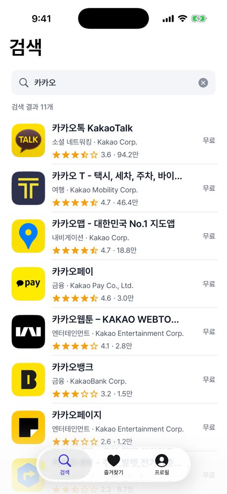
  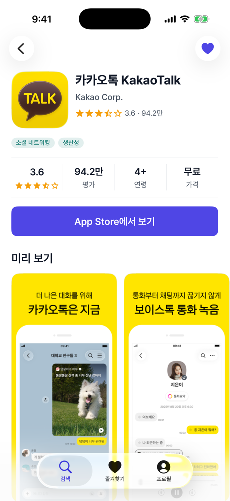
  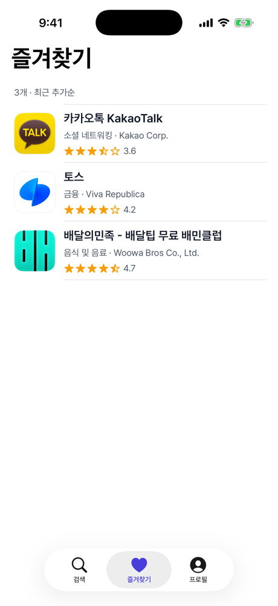
  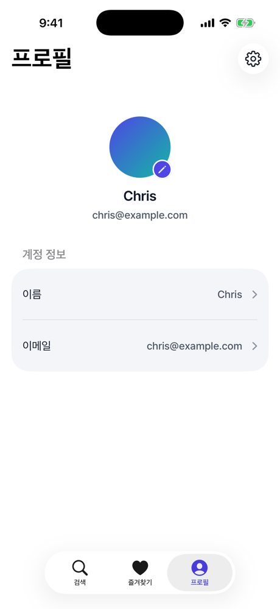
</p>

## 주요 기능

- **검색:** 300ms 디바운스 자동 검색, 리턴 키 즉시 검색, 최근 검색어(최대 10개, 개별·전체 삭제), 20개씩 무한 스크롤
- **상세:** 목록에서 받은 요약으로 상단을 먼저 그리고 나머지는 스켈레톤 → 태그, 요약 지표, 스크린샷, 설명 더 보기, 새로운 기능, 정보, App Store 열기
- **즐겨찾기:** 로컬 DB 저장, DB 관찰 스트림으로 목록과 하트가 항상 같은 값을 보여 줌, 스와이프 삭제
- **프로필:** 이름·이메일 편집(클라이언트·서버 같은 검증 규칙, 인라인 오류), 사진 변경(PhotosPicker → 1024px JPEG 압축 → 업로드)
- **설정:** 화면 모드(시스템/라이트/다크, 재실행 후 유지), 최근 검색어 전체 삭제, 앱 버전, 오픈소스 라이선스
- **요청 상태 처리:** 스켈레톤, 에러 + 다시 시도, 404는 다시 시도 없이, 다음 페이지 실패는 목록 하단에서만 재시도, 저장 실패 알럿
- **테스트:** 모든 리듀서를 TestStore로 검증 (Swift Testing, iOS 71개 + 서버 pytest 8개)

## 기술 스택

| 구분 | 사용 기술 |
|---|---|
| 앱 | Swift 5 모드, SwiftUI, iOS 17+, Xcode 26 |
| 아키텍처 | TCA 1.26 (`@Reducer`, `@ObservableState`, `StackState` 내비게이션, `@Presents`, `@Shared`, delegate) |
| 의존성 주입 | swift-dependencies (`@DependencyClient` UseCase, interface / live 분리) |
| 모듈화 | Tuist (Feature / Domain / Data / Core / Shared, 모듈별 테스트 타깃) |
| 네트워크 | Alamofire (`HTTPClient` 프로토콜 하나로 감쌈) |
| 로컬 DB | SQLiteData (GRDB 기반, 마이그레이션, 변경 관찰 스트림) |
| 이미지 | Kingfisher (메모리·디스크 캐시, 다운샘플링) |
| 폰트 | Pretendard |
| 테스트 | Swift Testing, TCA TestStore, URLProtocol 스텁, 메모리 DB |
| 서버 | Python 3.12, FastAPI, SQLAlchemy 2, Pydantic 2, MySQL 8.4 (Docker Compose) |

## 화면

### 검색

| 처음 | 최근 검색어 | 검색 결과 | 결과 없음 |
|:---:|:---:|:---:|:---:|
| 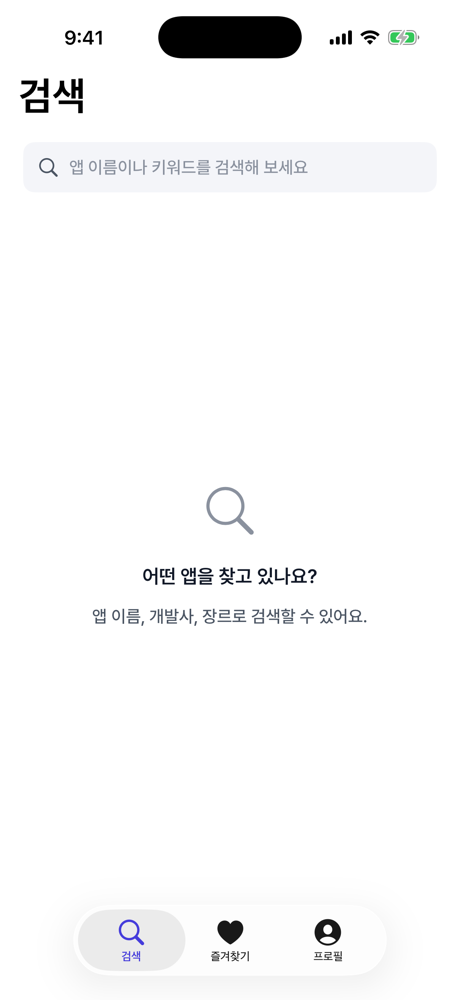 | 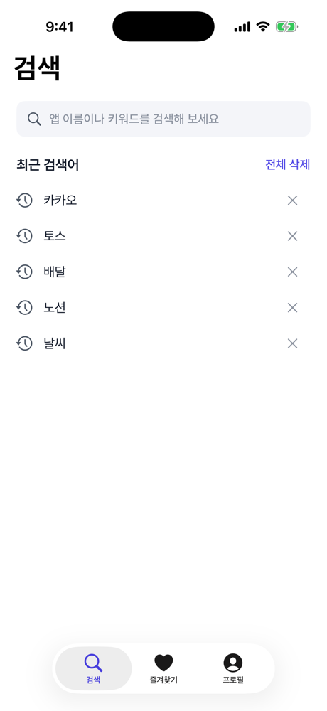 |  | 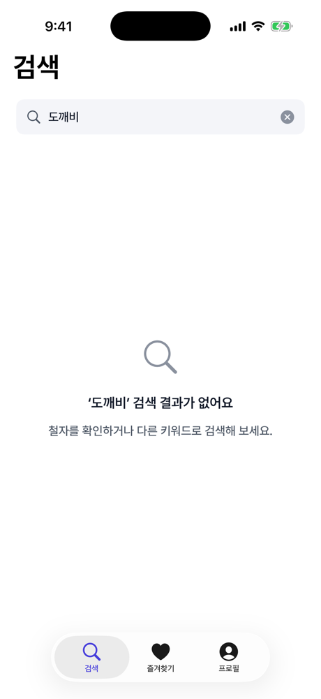 |

- **최근 검색어:** 검색창이 비어 있으면 최근 검색어를 최신순으로 보여 줍니다. 대소문자·앞뒤 공백이 다른 같은 검색어는 하나로 합칩니다. 목록은 DB 관찰 스트림으로만 갱신되므로 ✕를 누르면 DB에서 지우기만 하고 화면은 스트림이 바꿉니다.
- **자동 검색:** 입력을 300ms 멈추면 검색합니다. 새 검색이 시작되면 이전 요청과 다음 페이지 요청을 취소해서, 늦게 도착한 옛 응답이 화면을 덮어쓰지 않습니다. 자동 검색은 최근 검색어에 저장하지 않습니다.
- **즉시 검색:** 리턴 키나 최근 검색어를 누르면 디바운스 없이 검색하고 최근 검색어에 저장합니다. 저장 실패는 검색을 막지 않으므로 알리지 않습니다.
- **무한 스크롤:** 끝에서 5번째 셀이 보이면 다음 20개를 이어 붙입니다. 하단에 "불러오는 중 / 다시 시도 / 모든 결과를 확인했어요"를 보여 주고, 실패한 뒤에는 스크롤로 자동 재시도하지 않고 버튼으로만 다시 시도합니다.
- ✕로 검색어를 지우면 결과, 에러, 진행 중 요청을 모두 정리하고 최근 검색어로 돌아갑니다.

### 상세

| 상단 | 즐겨찾기 상태 | 다크 모드 |
|:---:|:---:|:---:|
|  | 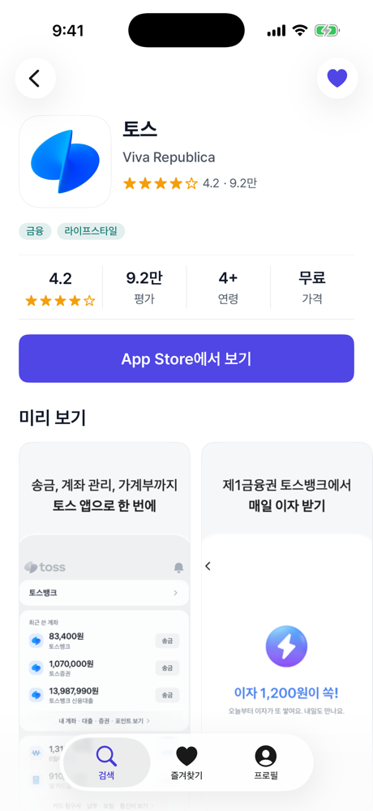 | 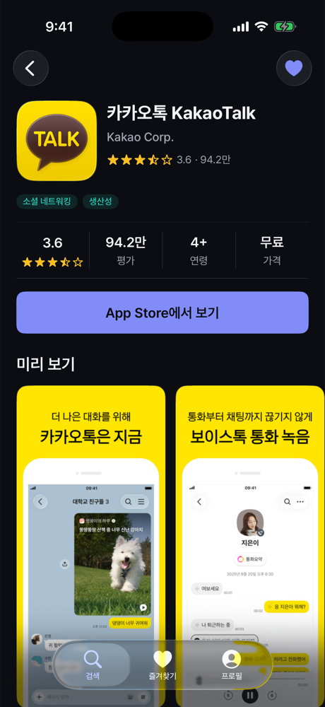 |

- 목록에서 받은 `AppSummary`로 아이콘, 이름, 개발사, 별점을 **즉시** 그리고, 나머지는 같은 크기의 스켈레톤을 보여 줍니다(전체 화면 스피너 없음).
- 응답이 오면 장르 태그, 요약 지표 4칸(평점·평가 수·연령·가격), App Store 버튼, 스크린샷 가로 스크롤, 설명(3줄 + 더 보기), 새로운 기능, 정보(크기·호환성 등)를 표시합니다.
- 실패하면 헤더는 그대로 두고 아래에 에러와 다시 시도를 보여 줍니다. 404면 다시 시도해도 결과가 같으므로 버튼을 숨깁니다.
- **즐겨찾기 ♡/♥:** 하트를 누르면 DB만 바꾸고, 하트 모양은 `observeIsFavorite` 스트림이 바꿉니다(낙관적 업데이트 없음). 그래서 즐겨찾기 탭과 상세 화면의 상태가 어긋나지 않습니다. 토글이 끝나기 전 연속 탭은 무시해서 경쟁 상태를 막습니다.
- 스크롤해서 앱 이름이 가려지면 내비게이션 바에 이름이 나타납니다.

### 즐겨찾기

| 목록 | 비어 있음 | 다크 모드 |
|:---:|:---:|:---:|
|  | 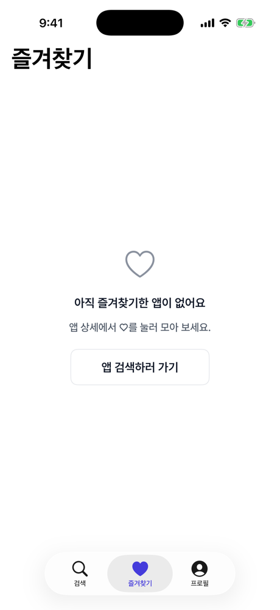 | 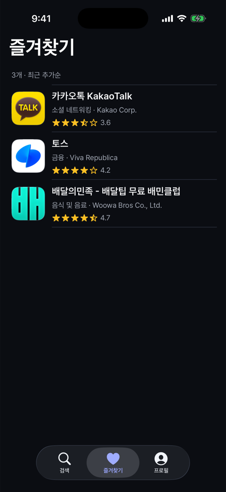 |

- 로컬 DB에 저장한 스냅샷이라 오프라인에서도 보입니다. 최신 정보는 셀을 눌러 상세에서 서버로 받습니다.
- 목록은 DB 관찰 스트림으로만 갱신합니다. 상세에서 ♥를 해제하고 돌아오면 그 셀은 이미 사라져 있습니다.
- 스와이프로 바로 삭제하고, 실패하면 알럿을 띄웁니다.
- **앱 검색하러 가기:** 즐겨찾기 화면은 탭을 바꿀 수 없으므로 `delegate(.searchTabRequested)`로 알리고, `RootFeature`가 검색 탭으로 전환합니다.

### 프로필과 설정

| 프로필 | 이메일 편집 | 형식 오류 | 설정 |
|:---:|:---:|:---:|:---:|
|  | 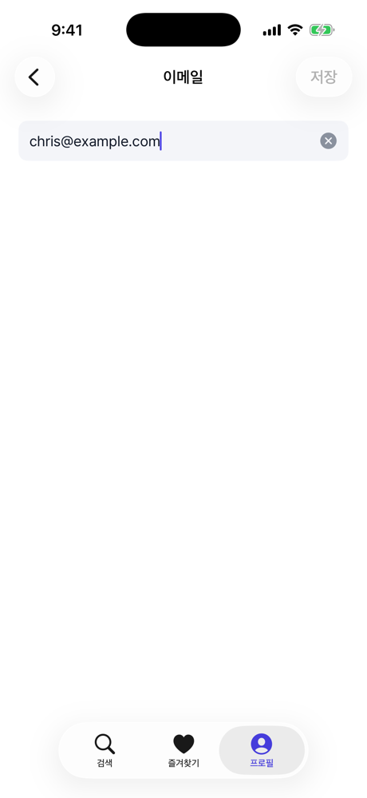 | 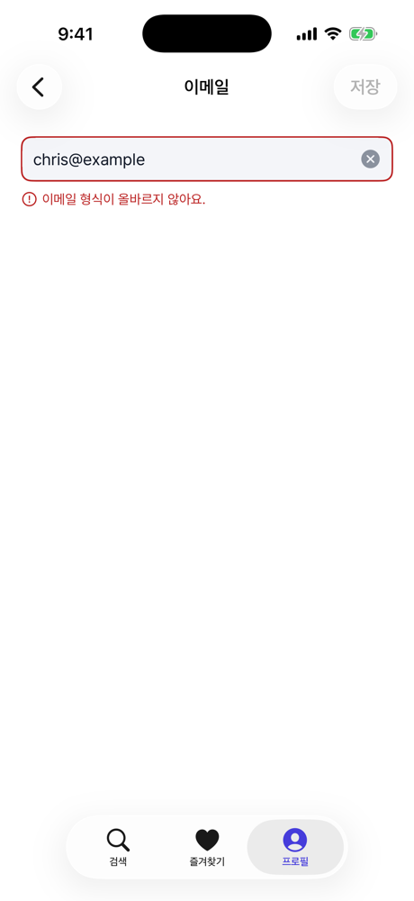 | 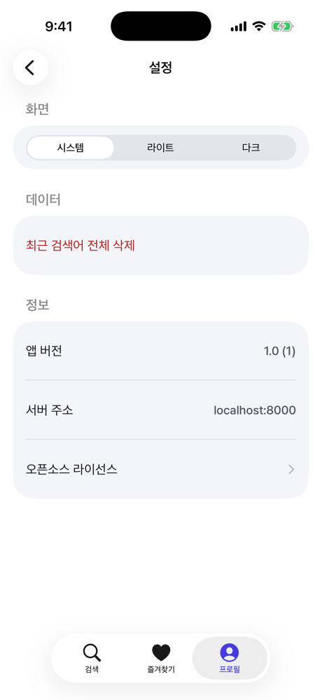 |

- **프로필:** 탭에 들어올 때마다 다시 조회합니다. 처음에만 로딩·에러를 보여 주고, 이미 프로필이 있으면 실패해도 기존 값을 유지합니다.
- **편집:** 이름과 이메일은 하나의 `EditFieldFeature`가 편집 대상만 바꿔 처리합니다.
  - 진입하면 자동 포커스, 이름은 글자 수 "N/20"을 보여 줍니다.
  - 값이 바뀌었고 형식이 맞을 때만 저장 버튼이 켜집니다. 형식 오류는 입력이 0.5초 멈추거나 저장을 시도하면 인라인으로 보여 줍니다.
  - 서버 검증 실패(422)는 인라인 오류, 네트워크 오류는 알럿으로 나눕니다.
  - 저장에 성공하면 `delegate(.profileUpdated)`로 새 프로필을 넘기고 `dismiss()`로 스스로 닫습니다. 프로필 화면은 다시 조회하지 않고 받은 값으로 바로 갱신합니다.
- **사진 변경:** 사진을 누르면 PhotosPicker(권한 요청 없음)가 열리고, 고른 사진은 Data 계층이 긴 변 1024px JPEG로 줄여서 올립니다. 업로드 중에는 스피너를 보여 주고 중복 선택을 막습니다.
- **설정:** 프로필 툴바 ⚙로 들어갑니다. 화면 모드는 `@Shared(.appStorage)`라서 고르는 즉시 앱 전체에 적용되고 재실행 후에도 유지됩니다. 최근 검색어 전체 삭제는 확인 다이얼로그를 거치고, 지울 검색어가 없으면 비활성입니다. 서버 주소는 Debug 빌드에서만 보입니다.

## 시작하기

### 준비

- macOS + Xcode 26 이상 (iOS 17 이상 시뮬레이터)
- [mise](https://mise.jdx.dev) 또는 [Tuist](https://tuist.dev) 4
- Docker Desktop (서버용)

### 1. 설치

```sh
git clone https://github.com/ios-carki/AppScout_iOS.git
cd AppScout_iOS
```

### 2. 서버 실행

```sh
cd Server
cp .env.example .env              # DB 계정, 포트 (필요하면 수정)
docker compose up -d --build      # MySQL이 healthy가 된 뒤 API 시작
cd ..
```

- 처음 켜면 `Server/seed/apps.json`(iTunes Search API에서 받은 앱 299개)과 고정 사용자 1명(Chris)이 들어갑니다.
- 켜졌는지 확인: `curl http://localhost:8000/health` → `{"status":"ok"}`
- API 문서(Swagger): http://localhost:8000/docs
- 끄기: `docker compose down` (데이터 유지), `docker compose down -v` (DB·업로드 이미지까지 삭제 → 다음 실행 때 다시 시드)

Docker 없이 실행할 수도 있습니다. `DATABASE_URL`이 없으면 SQLite 파일(`Server/appscout.db`)을 씁니다.

```sh
cd Server
python3.13 -m venv .venv && .venv/bin/pip install -r requirements-dev.txt
.venv/bin/uvicorn app.main:app --reload
```

- Python 3.14는 고정한 pydantic-core 버전의 휠이 없어 설치가 실패합니다. 3.12 또는 3.13을 쓰세요.
- 시드 갱신: `.venv/bin/python -m app.seed --refresh` (iTunes에서 다시 받아 `seed/apps.json` 덮어쓰기 + DB 반영)

### 3. 서버 주소 (xcconfig)

서버 주소는 코드에 없고 `Configs/*.xcconfig` → Info.plist `APIBaseURL` → `APIConfiguration` 순서로 전달됩니다.

| 파일 | 내용 |
|---|---|
| `Configs/Shared.xcconfig` | 모든 구성 공통. `API_SCHEME`, `API_HOST`(기본 `localhost:8000`), `API_BASE_URL`, `APP_DISPLAY_NAME` |
| `Configs/Debug.xcconfig` | `BUNDLE_ID_SUFFIX = .dev`, 앱 이름 "AppScout Dev" (Release 앱과 함께 설치 가능) |
| `Configs/Release.xcconfig` | 접미사 없음 |

| 실행 기기 | `API_HOST` |
|---|---|
| iOS 시뮬레이터 | `localhost:8000` (기본값) |
| 실제 iPhone | `<Mac의 LAN IP>:8000` (iPhone과 Mac이 같은 Wi-Fi) |

- xcconfig에서 `//`는 주석으로 읽히기 때문에 URL은 `$(API_SCHEME):/$()/$(API_HOST)`로 이어 붙입니다.
- Info.plist에 `NSAllowsLocalNetworking`이 있어서 로컬 네트워크의 http 접속이 허용됩니다.

### 4. 앱 실행

```sh
mise install          # tuist 설치 (mise.toml) — Tuist가 이미 있으면 생략
tuist install         # SPM 의존성 받기
tuist generate        # AppScout.xcworkspace 생성 후 Xcode 열림
```

`AppScout` 스킴을 iOS 17 이상 시뮬레이터에서 실행합니다.

### 5. 테스트

```sh
# iOS: 모듈별 스킴 (Domain, Data, Networking, Database, DesignSystem, SearchFeature, AppDetailFeature,
#       FavoritesFeature, ProfileFeature, SettingsFeature, RootFeature)
xcodebuild test -workspace AppScout.xcworkspace -scheme SearchFeature \
  -destination 'platform=iOS Simulator,name=iPhone 17'

# 실행 중인 로컬 서버에 실제로 요청하는 통합 테스트 (기본은 건너뜀)
TEST_RUNNER_APPSCOUT_INTEGRATION=1 xcodebuild test -workspace AppScout.xcworkspace -scheme Data \
  -destination 'platform=iOS Simulator,name=iPhone 17'

# 서버
cd Server && python3.13 -m venv .venv && .venv/bin/pip install -r requirements-dev.txt
.venv/bin/pytest
```

## API 요약

인증 없이 모든 요청을 고정 사용자(`id = 1`)로 처리합니다. 필드 이름은 snake_case, 날짜는 `2026-11-03T09:00:00Z` 형식입니다.
에러는 항상 `{ "code": "invalid_email", "message": "이메일 형식이 올바르지 않아요." }` 형식이라, 앱은 `DomainError`로 바꿔 `message`를 그대로 보여 줍니다.

| 메서드 | 경로 | 설명 |
|---|---|---|
| GET | `/health` | 상태 확인 |
| GET | `/v1/apps/search?term=&limit=20&offset=0` | 이름·개발사·장르 검색 (평가 수 많은 순) → `{ total, limit, offset, items }` |
| GET | `/v1/apps/{id}` | 상세 (설명, 스크린샷, 장르, 버전, 크기, 연령 등급 …), 없으면 404 |
| GET | `/v1/users/me` | 내 프로필 |
| PATCH | `/v1/users/me` | 이름·이메일 수정 (보낸 필드만), 검증 실패 422 |
| PUT | `/v1/users/me/avatar` | 프로필 사진 업로드 (multipart `file`, JPEG/PNG, 5MB 이하) |

자세한 요청·응답 형식은 서버를 켠 뒤 Swagger(http://localhost:8000/docs)에서 확인하고 직접 보내 볼 수 있습니다.

## 폴더 구조

```
├── Projects/
│   ├── App/                 조립 지점: live 의존성 연결, 폰트 등록, Store 생성
│   ├── Feature/
│   │   ├── RootFeature      탭 3개 조립, 자식 delegate 처리, 테마 적용
│   │   ├── SearchFeature    검색, 최근 검색어, 결과 목록(페이지네이션)
│   │   ├── AppDetailFeature 상세, 스크린샷, 즐겨찾기 토글
│   │   ├── FavoritesFeature 즐겨찾기 목록, 스와이프 삭제
│   │   ├── ProfileFeature   프로필, 이름·이메일 편집(EditFieldFeature), 사진 업로드
│   │   └── SettingsFeature  화면 모드(@Shared), 최근 검색어 삭제, 라이선스
│   ├── Domain/              Entity, Repository 프로토콜, UseCase(@DependencyClient), DomainError, 검증 규칙
│   ├── Data/                DTO, API(Endpoint), Mapper, RepositoryImpl, 에러 변환, 이미지 압축
│   ├── Core/
│   │   ├── Networking       HTTPClient(Alamofire), Endpoint, NetworkError, 로깅
│   │   └── Database         SQLiteData 설정, 마이그레이션, @Table 레코드
│   └── Shared/
│       └── DesignSystem     컬러·타이포그래피·간격 토큰, Pretendard, 공용 컴포넌트
├── Configs/                 xcconfig (서버 주소, 번들 ID 접미사)
├── Tuist/                   의존성(Package.swift), 모듈 helper
├── Server/                  FastAPI + MySQL 서버, 시드 데이터, pytest
├── docs/wireframe/          와이어프레임 & 디자인 스펙 PDF (HTML 소스 포함)
└── screenshots/             README 이미지
```

의존 방향은 한쪽으로만 흐릅니다: `App → Feature → Domain ← Data → Core`. Feature는 Data·Networking·Database를 전혀 모르고 `@Dependency(\.searchAppsUseCase)` 같은 UseCase만 씁니다. 실제 구현은 App 모듈이 `liveValue`로 연결합니다.

## 내비게이션 구조

```
RootView (TabView)
├ 검색 (NavigationStack, StackState)
│  └ 상세 (AppDetailFeature)
├ 즐겨찾기 (NavigationStack, StackState)
│  └ 상세 (AppDetailFeature 재사용)
└ 프로필 (NavigationStack, StackState)
   ├ 이름 / 이메일 편집 (EditFieldFeature)
   └ 설정 (SettingsFeature)
      └ 오픈소스 라이선스
```

각 탭은 `@Reducer enum Path` + `StackState`로 push를 관리합니다. 자식 화면은 부모를 직접 바꾸지 않고 `delegate` 액션으로 알리며(편집 완료, 검색 탭 요청), 스스로 닫을 때는 `@Dependency(\.dismiss)`를 씁니다.

## 와이어프레임

[docs/wireframe/AppScout_Wireframe.pdf](docs/wireframe/AppScout_Wireframe.pdf)에 화면별 레드라인과 레이어 스펙(크기, 여백, 컬러·타이포그래피 토큰, 상태, 액션)이 있습니다. 소스는 `docs/wireframe/src`의 HTML/JS입니다.
